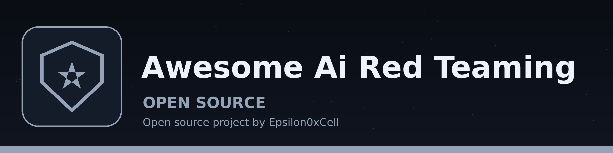

# Awesome AI Red Teaming

  

**A field guide for red teaming AI systems and the applications around them, where entries earn their place by being checkable.**

Most awesome lists are bookmarks with better formatting. This one is built for the middle of an engagement: every section follows the order you actually work in, every entry says what you will be able to do after using it, and wherever the format allows, the entry carries its verification: an OWASP test ID, a fixture, or a runnable check. Three of those checks ship in this repo under [`checks/`](checks/), ready to run against your own systems.

For authorised testing only: your own applications, labs, CTFs, and engagements with written permission.

## Contents

- [Start here](#start-here)
- [Standards and guidance](#standards-and-guidance)
- [Recon and attack-surface mapping](#recon-and-attack-surface-mapping)
- [Web and API testing](#web-and-api-testing)
- [LLM and agent red teaming](#llm-and-agent-red-teaming)
- [Guardrails and evaluation](#guardrails-and-evaluation)
- [Benchmarks and datasets](#benchmarks-and-datasets)
- [Privilege escalation](#privilege-escalation)
- [Active Directory and cloud](#active-directory-and-cloud)
- [Verification: is it actually a finding](#verification-is-it-actually-a-finding)
- [Detection: what should have caught it](#detection-what-should-have-caught-it)
- [Reporting](#reporting)
- [Papers and research hubs](#papers-and-research-hubs)
- [Learning paths](#learning-paths)
- [Courses and labs](#courses-and-labs)
- [CTFs and challenges](#ctfs-and-challenges)
- [Communities and newsletters](#communities-and-newsletters)
- [Contributing](#contributing)
- [License](#license)

## Start here

- [NIST SP 800-115, Technical Guide to Information Security Testing and Assessment](https://csrc.nist.gov/pubs/sp/800/115/final): the assessment loop the rest of this guide hangs on, including the rule that reporting happens during testing, not after it.
- [MITRE ATT&CK](https://attack.mitre.org/): the shared taxonomy for tagging every technique you use, so your notes stay searchable and your detections map to something defenders already track.
- [MITRE ATLAS](https://atlas.mitre.org/): the ATT&CK counterpart for AI systems. Tag LLM findings here, not in a private vocabulary.
- [SecLists](https://github.com/danielmiessler/SecLists): the wordlists, payloads, and fuzzing strings every later section assumes you have. Specificity beats size; pick the smallest list that matches the target.

[Back to top](#contents)

## Standards and guidance

The frameworks findings get named and graded against. OWASP owns the AI-specific lists; NIST owns the risk vocabulary.

- [OWASP Top 10 for Agentic Applications](https://genai.owasp.org/2025/12/09/owasp-top-10-for-agentic-applications-the-benchmark-for-agentic-security-in-the-age-of-autonomous-ai/) - Ten agent risks with ASI codes, from goal hijack to rogue agents; OWASP GenAI Security Project, December 2025.
- [OWASP MCP Top 10](https://owasp.org/projects/mcp-top-10) - Ten risks specific to Model Context Protocol servers, tools, and transports; OWASP project, companion to the LLM list.
- [OWASP GenAI Red Teaming Guide](https://genai.owasp.org/resource/genai-red-teaming-guide/) - Methodology for planning, scoping, and running red-team exercises against GenAI systems; OWASP GenAI Security Project.
- [NIST AI 100-2e2025](https://csrc.nist.gov/pubs/ai/100/2/e2025/final) - The adversarial machine learning taxonomy: attacks and mitigations in shared terminology; NIST, 2025 edition.
- [NIST AI 600-1](https://doi.org/10.6028/NIST.AI.600-1) - Generative AI profile naming twelve risks with suggested actions per category; NIST, July 2024.
- [NIST AI Risk Management Framework](https://doi.org/10.6028/NIST.AI.100-1) - Govern, Map, Measure, Manage: the voluntary structure AI risk programs hang on; NIST AI 100-1, 2023.

[Back to top](#contents)

## Recon and attack-surface mapping

- [Nmap](https://nmap.org/): the port and service scanner everything else builds on. Two-stage discipline: full-range discovery first, version and script scans on the open set only.
- [AutoRecon](https://github.com/Tib3rius/AutoRecon): a baseline enumerator to run in the background with a pruned config while you work the interesting services by hand.
- [subfinder](https://github.com/projectdiscovery/subfinder): passive subdomain discovery from public sources, so your map exists before you send a single probe.
- [httpx](https://github.com/projectdiscovery/httpx): fast HTTP probing over a host list: titles, status, technology, so a thousand names become a short list worth reading.
- [HackTricks](https://book.hacktricks.xyz/): per-service depth, reached for at the moment a service is in front of you. Paraphrase and verify against the live target; never paste blindly.

Verify: the surface is mapped when you can state the count (hosts, services, endpoints) and every service carries a status of exhausted or unexplored. If you cannot state the count, the recon is not done.

[Back to top](#contents)

## Web and API testing

- [OWASP Web Security Testing Guide](https://owasp.org/www-project-web-security-testing-guide/): the indexed checklist this section is keyed to. Cite test IDs (for example WSTG-INFO-01) in your notes instead of prose descriptions. Source: [OWASP/wstg](https://github.com/OWASP/wstg).
- [PortSwigger Web Security Academy](https://portswigger.net/web-security): the free, lab-backed reference for every major web vulnerability class, each with an exploitable practice instance.
- [OWASP Cheat Sheet Series](https://cheatsheetseries.owasp.org/): the defensive counterpart. Read the cheat sheet for the control you are testing; it tells you exactly what correct looks like, which is what makes a bypass provable.
- [PayloadsAllTheThings](https://github.com/swisskyrepo/PayloadsAllTheThings): payload and bypass references per vulnerability class, to adapt to the target in front of you, never to spray untested.
- [ffuf](https://github.com/ffuf/ffuf): the fast fuzzer for content, parameters, and virtual hosts. At lab latency, list choice matters more than tool choice.
- [gobuster](https://github.com/OJ/gobuster): directory, DNS, and virtual-host enumeration with predictable output for your records.
- [sqlmap](https://github.com/sqlmapproject/sqlmap): automated SQL injection confirmation and exploitation, after a manual check has shown the parameter is worth it.
- [ZAP](https://www.zaproxy.org/): the open-source intercepting proxy and scanner for crawling, session handling, and API exploration.

Verify: the checks in [`checks/`](checks/) cover headers, TLS expiry, and exposed artefact paths for any web target you own. A scanner hit becomes a candidate; the verification section below decides what it is worth.

[Back to top](#contents)

## LLM and agent red teaming

- [OWASP Top 10 for LLM Applications](https://genai.owasp.org/llm-top-10/): the risk taxonomy for LLM features, starting with prompt injection (LLM01). Use its category names in findings so vendors and maintainers share your vocabulary.
- [garak](https://github.com/NVIDIA/garak): the LLM vulnerability scanner. Probes for injection, leakage, and jailbreak classes with repeatable runs you can cite as fixtures.
- [PyRIT](https://github.com/microsoft/PyRIT): Microsoft's automation framework for multi-turn red-team campaigns against models and agents, with scored datasets instead of anecdote.
- [promptfoo](https://github.com/promptfoo/promptfoo): evaluation and red-team testing for prompts and agents that runs in CI, so a regression in a system prompt shows up as a failing test.
- The skills pack built for this workflow: [ai-redteam-skills](https://github.com/Epsilon0xCell/ai-redteam-skills): counted recon, prompt-injection testing with controls, verification discipline, and detection pairing, as SKILL.md files an agent can follow step by step.

- [DeepTeam](https://github.com/confident-ai/deepteam) - Red-teaming framework testing fifty-plus vulnerability classes with OWASP and NIST mappings; Confident AI, 3.1k stars.
- [Giskard](https://github.com/Giskard-AI/giskard-oss) - Open-source testing library scanning models and agents for injection, hallucination, and bias; 5.9k stars, releases through 2026.
- [AI-Infra-Guard](https://github.com/Tencent/AI-Infra-Guard) - Scans AI infrastructure, agents, and MCP servers for exploitable weaknesses; Tencent-maintained, 7.5k stars.
- [mcp-scan](https://github.com/snyk/agent-scan) - Scans MCP configurations for tool poisoning, rug pulls, and cross-server shadowing; Invariant Labs, now Snyk agent-scan, 3.2k stars.
- [SkillSpector](https://github.com/NVIDIA/SkillSpector) - Scans AI agent skills for malicious instructions before installation; NVIDIA-maintained, 25.7k stars.

Verify: an injection result counts only when a real boundary breaks: unauthorised data read, an unauthorised action taken, or a developer constraint that protects someone else overridden. A compliant tone change is an observation, not a finding. Run the benign control in a fresh session before you believe any probe.

[Back to top](#contents)

## Guardrails and evaluation

The defensive half of the same engagement: evaluation harnesses and runtime rails your findings get tested against. Start with Inspect AI; it is the harness the frontier labs build on.

- [Inspect AI](https://github.com/UKGovernmentBEIS/inspect_ai) - Evaluation framework with tasks, solvers, scorers, and sandboxed agent runs; UK AI Security Institute, 3.2k stars.
- [NeMo Guardrails](https://github.com/NVIDIA-NeMo/Guardrails) - Programmable Colang rails controlling input, dialog, retrieval, and output; NVIDIA-maintained, 7.5k stars.
- [Guardrails AI](https://github.com/guardrails-ai/guardrails) - Composable validators checking structured model output before it reaches users; Apache-2.0, 7.6k stars.
- [LLM Guard](https://github.com/protectai/llm-guard) - Scanner battery screening inputs and outputs for injection, PII, and secrets; Protect AI, 3.2k stars.
- [DeepEval](https://github.com/confident-ai/deepeval) - Pytest-style evaluation framework with fifty-plus metrics for outputs and agents; Confident AI, 19.5k stars.
- [OpenAI Guardrails](https://github.com/openai/openai-guardrails-python) - Input, output, and tool guardrails for the Agents SDK; OpenAI-maintained, the vendor reference implementation.
- [Purple Llama](https://github.com/meta-llama/PurpleLlama) - Open guard stack with Llama Guard classifiers, Prompt Guard, and LlamaFirewall; Meta-maintained, 4.5k stars.
- [Microsoft Agent Governance Toolkit](https://github.com/microsoft/agent-governance-toolkit) - Runtime policy enforcement, agent identity, and sandboxing for agent frameworks; Microsoft, released April 2026, MIT.
- [Petri](https://github.com/meridianlabs-ai/inspect_petri) - Automated behavioural auditor probing models for deception, sycophancy, and power-seeking; Anthropic-born, now Meridian Labs, 1.4k stars.

[Back to top](#contents)

## Benchmarks and datasets

Fixed targets with published scoring, so a claim about a model or a defence can be re-run by someone else. HarmBench and JailbreakBench are the default pair; the agent benchmarks below them cover tool use.

- [HarmBench](https://www.harmbench.org/) - Standardised automated red-teaming framework with 510 behaviours and classifier grading; Center for AI Safety, ICML 2024.
- [JailbreakBench](https://jailbreakbench.github.io/) - Open jailbreak robustness benchmark and leaderboard scoring harmful and benign behaviours; NeurIPS 2024 Datasets and Benchmarks track.
- [AgentHarm](https://arxiv.org/abs/2410.09024) - Benchmark of 110 malicious agent tasks across eleven harm categories; Gray Swan AI with UK AISI, ICLR 2025.
- [AgentDojo](https://github.com/ethz-spylab/agentdojo) - Dynamic environment testing indirect prompt injection against tool-using agents; ETH Zurich SPY Lab, NeurIPS 2024.
- [InjecAgent](https://github.com/uiuc-kang-lab/InjecAgent) - Static benchmark of 1,054 indirect-injection cases across seventeen user tools; UIUC Kang Lab, ACL 2024 Findings.
- [CyberSecEval](https://github.com/meta-llama/PurpleLlama/tree/main/CybersecurityBenchmarks) - Cyber-risk evaluation suite covering insecure code, attack assistance, and prompt injection; Meta, ships inside Purple Llama.
- [SocialHarmBench](https://huggingface.co/datasets/psyonp/SocialHarmBench) - Sociopolitical-harm prompt set spanning thirty-four countries beyond US-centric harm categories; ICLR 2026, hosted on Hugging Face.

[Back to top](#contents)

## Privilege escalation

- [PEASS-ng](https://github.com/PEASS-ng/PEASS-ng): LinPEAS and WinPEAS for local enumeration. Lead generation only: verify every lead by hand before acting on it, and never let its output ordering set your priorities.
- [GTFOBins](https://gtfobins.github.io/): which Unix binaries break out of restricted shells through sudo and SUID, checked against what your enumeration actually found.
- [LOLBAS](https://lolbas-project.github.io/): the Windows counterpart: living-off-the-land binaries and scripts and what each can be made to do.
- [hashcat](https://hashcat.net/hashcat/): the password cracker. Identify the hash mode first; the wrong mode is the most common wasted GPU hour.

[Back to top](#contents)

## Active Directory and cloud

- [BloodHound](https://github.com/SpecterOps/BloodHound): graph analysis of an AD environment, so the shortest path to the objective replaces wandering.
- [NetExec](https://github.com/Pennyw0rth/NetExec): the maintained network exploitation toolkit for validating credentials and enumerating Windows estates. Its predecessor is archived; old writeups translate mechanically.
- [Certipy](https://github.com/ly4k/Certipy): AD Certificate Services enumeration and abuse, run as soon as any domain credential exists and again after every new one, because what is enrollable differs by principal.
- [impacket](https://github.com/fortra/impacket): the protocol library underneath half the Windows tooling you will ever script.

Verify: password policy arithmetic before any spray. Budget is the lockout threshold minus one per account per window, and username validation through Kerberos pre-authentication does not spend that budget.

[Back to top](#contents)

## Verification: is it actually a finding

- [OSV](https://osv.dev/): the open-source vulnerability database for checking whether a candidate is already known, and under which ID, before you report a duplicate.
- [Exploit-DB](https://www.exploit-db.com/): the public exploit archive. Search it before claiming novelty and before trusting that a technique works as described.
- [CyberChef](https://gchq.github.io/CyberChef/): the encoding and decoding workbench for building and shrinking proof inputs.
- [pwntools](https://github.com/Gallopsled/pwntools): the CTF and exploit-development library whose cyclic patterns and remote plumbing make binary proofs reproducible.
- [nuclei](https://github.com/projectdiscovery/nuclei): template-based scanning whose templates double as published fixtures: a template that fires on the fixed version too is an incomplete-fix lead, not noise.
- [trivy](https://github.com/aquasecurity/trivy) and [gitleaks](https://github.com/gitleaks/gitleaks): dependency, container, and secret scanning for the supply-chain side of a target. Their output starts the same verification process as everything else here; it does not skip it.

The standard this guide applies: reproduced, controlled, minimal, proven end to end, and re-run from a fresh state, with the identical proof failing against the fixed version. Anything less is an unconfirmed candidate with the missing leg named.

[Back to top](#contents)

## Detection: what should have caught it

- The pairing discipline lives in [secure-coding-skills](https://github.com/Epsilon0xCell/secure-coding-skills) on the defensive side and in the `detection-pairing` skill of [ai-redteam-skills](https://github.com/Epsilon0xCell/ai-redteam-skills) on the offensive side: observable first, blind spot named by shape, a rule tested against the proof and against the benign control.
- [Sliver](https://github.com/BishopFox/sliver): a maintained command-and-control framework whose own documentation of its network behaviour is a study in what defenders can and cannot see. Know your tooling's signature before you rely on its quiet.

[Back to top](#contents)

## Reporting

- [The Hacker Recipes](https://www.thehacker.recipes/): concise, structured technique notes in the shape a good report section takes: preconditions, exact steps, expected result.
- The report kit built alongside this guide: [vuln-report-kit](https://github.com/Epsilon0xCell/vuln-report-kit): templates plus a completeness validator that checks a draft for the sections reviewers actually reject reports for missing.

A report that survives review states the boundary from the project's own documentation, the control beside the proof, the demonstrated impact in one sentence, and the ask in plain language. Score once, early, and move on.

[Back to top](#contents)

## Papers and research hubs

The primary sources the tooling descends from, and the hubs where new attacks and defences appear first.

- [Universal and Transferable Adversarial Attacks (GCG)](https://arxiv.org/abs/2307.15043) - The foundational gradient jailbreak later attacks position themselves against; Zou et al., CMU and CAIS, 2023.
- [Crescendo](https://arxiv.org/abs/2404.01833) - Multi-turn jailbreak escalating gradually across turns until the model complies; Microsoft, USENIX Security 2025.
- [Constitutional Classifiers](https://arxiv.org/abs/2501.18837) - Production defence cutting jailbreak success from 86 percent to 4.4 percent; Anthropic, arXiv 2501.18837, 2025.
- [Anthropic Alignment Science Blog](https://alignment.anthropic.com) - Primary-source posts on sabotage evaluations, hidden objectives, and behavioural auditing; Anthropic, updated through 2026.
- [Embrace The Red](https://embracethered.com) - Practitioner incident research documenting indirect prompt injection in shipping products; Johann Rehberger, updated through 2025.
- [Simon Willison's Weblog](https://simonwillison.net) - Running primary-source analysis of prompt injection and agent security as it breaks; he named the attack class in 2022.
- [Anthropic Frontier Red Team](https://www.anthropic.com/research/team/frontier-red-team) - The team page and publications behind Anthropic's frontier-model red teaming; Anthropic, posts through 2026.
- [Lessons from Red Teaming 100 Generative AI Products](https://www.microsoft.com/security/blog/2025/01/13/3-takeaways-from-red-teaming-100-generative-ai-products/) - Eight lessons from a hundred product red teams, including that gradients are unnecessary; Microsoft AI Red Team, January 2025.

[Back to top](#contents)

## Learning paths

- [Hack The Box](https://www.hackthebox.com/): the lab platform this guide's workflow was sharpened on, from Starting Point upward.
- [IppSec](https://ippsec.rocks/): searchable walkthrough videos indexed by service and technique. Search it when stuck, by the service in front of you.
- [0xdf](https://0xdf.gitlab.io/): written walkthroughs with the dead ends left in, which is where most of the teaching lives.
- [ligolo-ng](https://github.com/nicocha30/ligolo-ng) and [chisel](https://github.com/jpillora/chisel): the pivoting tools for the moment a lab stops being one host, and the point where drawing the topology map becomes non-negotiable.

[Back to top](#contents)

## Courses and labs

Structured practice with a curriculum behind it, as opposed to the open challenges in the next section.

- [HackAPrompt](https://www.hackaprompt.com/) - Global prompt-injection competition whose dataset doubles as attack training data; run by Learn Prompting.
- [AI Red Teaming Playground Labs](https://github.com/microsoft/ai-red-teaming-playground-labs) - Hands-on labs for practising attacks against small local AI systems; Microsoft AI Red Team, open source.
- [HackTheBox AI Red Teamer Path](https://academy.hackthebox.com/path/preview/ai-red-teamer) - Twelve-module job-role path ending in the COAE certification exam; built with Google, aligned to SAIF.

[Back to top](#contents)

## CTFs and challenges

Open arenas and games: no curriculum, a target, a scoreboard, and other players.

- [Gandalf](https://gandalf.lakera.ai) - The level-by-level password-extraction game that teaches prompt injection by doing; Lakera, free in the browser.
- [Gray Swan Arena](https://app.grayswan.ai/arena/about) - Competitive red-teaming arena with sponsored challenges against frontier models; Gray Swan, backed by UK AISI and frontier labs.
- [Crucible](https://crucible.dreadnode.io) - Challenge platform of scored AI security scenarios, from injection to agent abuse; Dreadnode, free to play.
- [Tensor Trust](https://tensortrust.ai) - Attack-and-defend prompt game whose player data became a robustness benchmark; UC Berkeley researchers.
- [Prompt Airlines](https://promptairlines.com) - Five-challenge CTF about talking an airline chatbot into a free flight; Wiz Research, free.

[Back to top](#contents)

## Communities and newsletters

Where practitioners compare notes between engagements, and where new techniques surface before they are papers.

- [AI Village](https://discord.com/invite/GX5fhfT) - The DEF CON village for AI security, with year-round challenges in its Discord; AI Village, community-run.
- [tl;dr sec](https://tldrsec.com) - Weekly security newsletter with a standing AppSec and AI security beat; Clint Gibler, free every Thursday.
- [CloudSecList](https://cloudseclist.com) - Weekly cloud security newsletter tracking AWS, Azure, GCP, and Kubernetes risk; community-curated, free.
- [OWASP GenAI Security Project](https://owasp.org/projects/genai-security) - The project home behind the LLM, Agentic, and MCP lists, with community channels; OWASP, open participation.

[Back to top](#contents)

## Contributing

The bar for entries, and what gets removed, is in [CONTRIBUTING.md](CONTRIBUTING.md). Quality over bulk, always: one verified entry beats twenty bookmarks.

[Back to top](#contents)

## License

The list is released under [CC0 1.0 Universal](LICENSE): copy it, build on it, no permission needed. The runnable checks under [`checks/`](checks/) stay under MIT; see the header in each script. Curated by Gavin Blacklock ([Epsilon0xCell](https://github.com/Epsilon0xCell)). Links belong to their projects; the curation and the verification notes are the original work here.

[Back to top](#contents)
